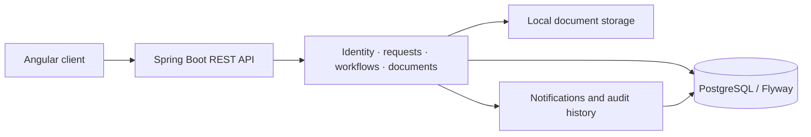

# Orchiva

Orchiva is a local portfolio demonstration of an internal request and document workflow. It brings draft requests, sequential approvals, supporting files, notifications, and audit history into one traceable workspace. It has no production deployment or external customers.

## What it does

- Session-based sign-in with Spring Security, CSRF protection, BCrypt password hashes, and role-based access for employees, managers, finance approvers, and administrators.
- Draft creation and editing, an explicit **Submit for approval** or **Keep as draft** choice, request search and filtering, server-side pagination, and lifecycle tracking.
- Versioned workflow definitions, a visual Workflow Studio, role-scoped Approval Inbox, sequential decisions, comments, and resubmission after requested changes.
- Authorized document upload and download, immutable document versions, persistent notifications, operational dashboard queries, and append-only audit events.
- Responsive Angular screens with light and dark themes, loading and error states, and keyboard-accessible controls.

## Stack and architecture

| Layer | Locally configured technology |
| --- | --- |
| Frontend | Angular 21 (lockfile: 21.2.26), TypeScript 5.9, SCSS, standalone components, signals, reactive forms |
| Backend | Java 21, Spring Boot 4.1.2, Spring MVC, Spring Security, Spring Data JPA/Hibernate, Bean Validation |
| Data | PostgreSQL 18, Flyway V1–V7, local filesystem document bytes |
| Build and tests | Maven 3.10, Node.js 24, npm 11, JUnit Jupiter/Spring Boot Test, Vitest/Angular testing utilities |

The backend is a **modular monolith**. Angular calls the REST API through a local development proxy; Spring application services enforce business rules and authorization; JPA persists metadata in PostgreSQL. Flyway owns schema changes, and Hibernate validates the migrated schema at startup. Document bytes live under a configurable local directory, while metadata and version history live in PostgreSQL. Published workflow versions remain attached to in-flight requests.



See [architecture](docs/architecture.md), [database model](docs/database-model.md), [workflow state machine](docs/workflow-state-machine.md), and [technical tradeoffs](docs/technical-tradeoffs.md).

## Screenshots to capture

No application screenshots are included yet. Capture genuine local screens before publication; see the [screenshot checklist](docs/screenshots.md). Recommended files and captions are:

| Planned path | Caption |
| --- | --- |
| `docs/screenshots/dashboard.png` | Role-scoped dashboard and current workload |
| `docs/screenshots/requests.png` | Searchable Requests workspace |
| `docs/screenshots/request-detail.png` | Request Details with approval progress and documents |
| `docs/screenshots/approval-inbox.png` | Pending manager decision with workflow context |
| `docs/screenshots/workflow-studio.png` | Versioned Workflow Studio |
| `docs/screenshots/audit-explorer.png` | Administrative audit history |

These are checklist paths, not image links. Add only screenshots captured from the running application and review them for personal data before publication.

## Run locally on Windows

This project was verified with Java 21, Maven 3.10, Node.js 24/npm 11, and PostgreSQL 18. Use the `backend/` and `frontend/` directories under your own project root; the paths are not tied to a particular machine. A running PostgreSQL instance and a dedicated application role/database are required. Follow [database setup](database/README.md) once if those resources do not already exist.

In a PowerShell terminal at the project root, enter the application role password for **this terminal session only**:

```powershell
$env:ORCHIVA_DB_PASSWORD = Read-Host 'Orchiva database password' -MaskInput
Set-Location .\backend
mvn spring-boot:run
```

`backend/src/main/resources/application.yml` defaults to `jdbc:postgresql://localhost:5432/orchiva` and user `orchiva_app`. Override `ORCHIVA_DB_URL`, `ORCHIVA_DB_USERNAME`, or `ORCHIVA_DOCUMENT_STORAGE` in your local environment if needed. The default document directory is `backend/var/documents` when started from `backend/`. Flyway applies pending V1–V7 migrations before Hibernate schema validation. Do not start against a database that contains unrelated data.

In a **second** PowerShell terminal at the project root:

```powershell
Set-Location .\frontend
npm.cmd ci
npm.cmd start
```

Open [http://localhost:4200](http://localhost:4200). The backend listens on [http://localhost:8080](http://localhost:8080); health is at `/api/health`, and local Swagger UI is at `/swagger-ui.html`. The Angular development proxy forwards API, Actuator, and OpenAPI routes to port 8080. Maven resolves through the project's Maven Central-only settings; npm uses the official npm registry.

### Local demo accounts

Flyway seeds fictional development identities. All four accounts initially use the password `password`: `employee` (request owner), `manager` (department approval), `finance` (next approval stage), and `admin` (administration and audit). **These credentials and seed records are for isolated local demonstration only.** Do not expose the application on a public network with these accounts. The [demo guide](docs/demo-guide.md) walks through the two-stage approval.

## Verify

From `backend/`:

```powershell
mvn test
mvn package
```

From `frontend/`:

```powershell
npm.cmd test -- --watch=false
npm.cmd run build
npm.cmd run check:approval-contrast
```

The native PostgreSQL integration test targets a separate `orchiva_test` database and runs only when `ORCHIVA_DB_PASSWORD` is present in the Maven process. It applies pending migrations without dropping or resetting existing tables. Without that variable, Maven reports the integration test as **skipped**. Token contrast checks do not replace visual browser inspection.

## Limits

Orchiva is a local demonstration, not a hardened production service. It uses in-process HTTP sessions, a local document store, local demo users, and a non-TLS development setup. Production use would require replacing demo credentials and seed policy, TLS and secure cookies, shared sessions, secrets management, backups, retention, file-content and malware scanning, and deployment-specific monitoring. Email delivery, cloud storage, and performance benchmarks are not part of this project.

