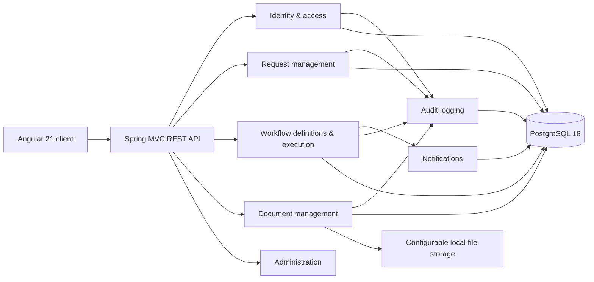

# Orchiva architecture

## Architectural style

Orchiva is a modular monolith. It runs locally as one Spring Boot API and one Angular client while preserving explicit business-module boundaries. This keeps local operations simple and supports cross-module transactions required by approval workflows.

## Module boundaries

- Controllers translate HTTP contracts and delegate immediately to application services.
- Application services own use cases, authorization orchestration, and transaction boundaries.
- Domain objects enforce workflow state transitions and invariants.
- Repositories encapsulate persistence; REST APIs never expose JPA entities directly.
- Cross-cutting platform code is limited to configuration, error handling, time, and observability.
- Document bytes use a storage abstraction; only metadata is stored in PostgreSQL.

## Security and transaction boundaries

- Spring Security stores authenticated state in the server-side HTTP session. The session identifier is HttpOnly and Angular sends a CSRF token for mutations.
- Method security protects administrative and approver routes; application services enforce request and document ownership or department scope.
- Request submission and workflow creation share one database transaction. A missing workflow rolls the submission back.
- Approval decisions acquire a pessimistic row lock and validate pending state again. Request, workflow, task, decision, notification, and audit changes commit atomically.
- JPA optimistic versions detect conflicting user/request updates.
- Published workflow versions are never edited. Each instance references the version selected at submission.

## Key decisions

| Decision | Rationale |
| --- | --- |
| Spring Boot 4.1.2 | Version pinned by the backend POM and used with the documented Java 21 and Maven 3.10 toolchain. |
| Angular 21 | Explicit project requirement; supported on the installed Node 24 runtime. |
| PostgreSQL + Flyway | Explicit, reviewable schema evolution without Hibernate-generated production DDL. |
| Modular monolith | Strong boundaries and transactional consistency without operational microservice overhead. |
| UTC persistence timestamps | Unambiguous audit and workflow event ordering across users and locations. |
| Environment configuration | Keeps database credentials and machine-specific paths outside source-ready files. |
| Maven Central-only mirror | Enforces the project's prohibition on GitHub and vendor package repository access. |
| Server-side browser session | Supports revocation and logout without putting bearer tokens in browser storage; requires CSRF protection and shared session storage if later scaled horizontally. |
| Local file storage abstraction | Keeps large binaries out of PostgreSQL while allowing a future storage adapter without changing document APIs. |
| Immutable workflow versions | Preserves reproducibility and auditability for in-flight requests. |
| Row locking for decisions | Serializes competing approval writes and prevents duplicate outcomes. |

See [database-model.md](database-model.md) and [workflow-state-machine.md](workflow-state-machine.md) for the persisted model and transition rules.

