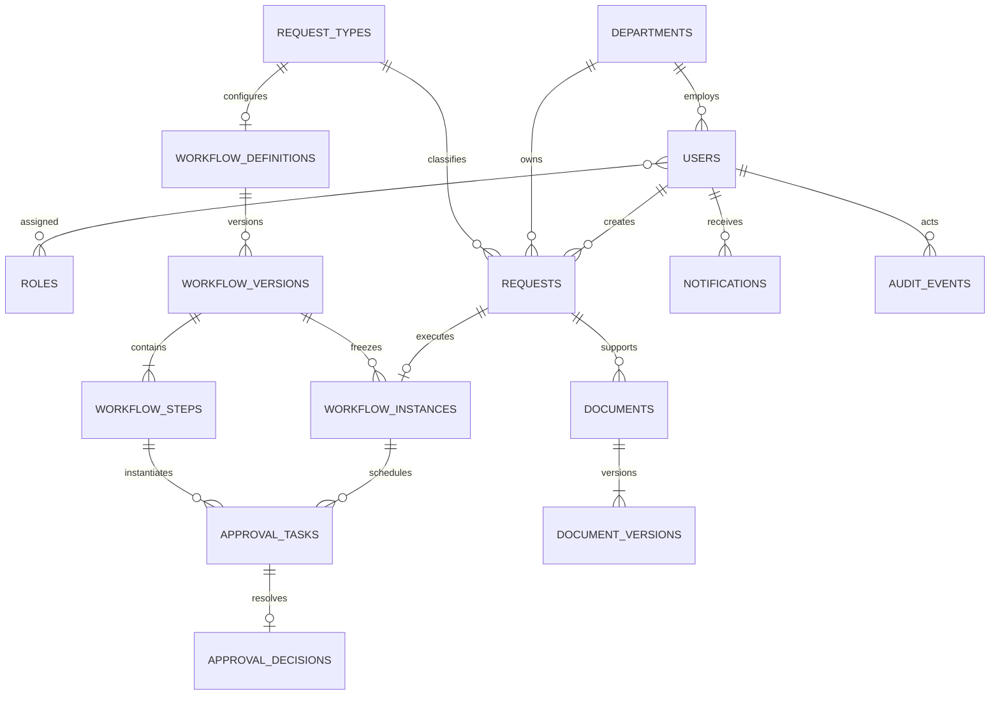

# Database model

Flyway owns all PostgreSQL schema changes. Hibernate runs with `ddl-auto: validate`, so application startup fails if entity mappings and the migrated schema diverge.

## Integrity controls

- UUID primary keys keep identifiers opaque at API boundaries.
- Unique constraints cover usernames, emails, department and request-type codes, request references, workflow version numbers, step positions, and document version numbers.
- Check constraints restrict persisted status and role values.
- Request, workflow instance, approval task, and user rows use optimistic versions where concurrent editing matters.
- A unique `(workflow_instance_id, workflow_step_id, attempt)` key permits resubmission while preventing duplicate tasks within an attempt.
- Foreign keys preserve the complete decision chain from request through immutable workflow version, task, actor, and decision.
- Audit events have no update or delete API.

## Migrations

| Version | Purpose |
| --- | --- |
| V1 | Platform foundation and initial setting |
| V2 | Users, roles, departments, and local demo identities |
| V3 | Request types, requests, status constraints, and indexes |
| V4 | Workflow versions, execution, decisions, audit, and notifications |
| V5 | Document metadata and version history |
| V6 | Internally consistent local demonstration scenarios |
| V7 | Forward-only compatibility repair ensuring approval decisions exist before Hibernate validation |

Administrators can inspect applied migrations through `GET /api/admin/migrations`.
