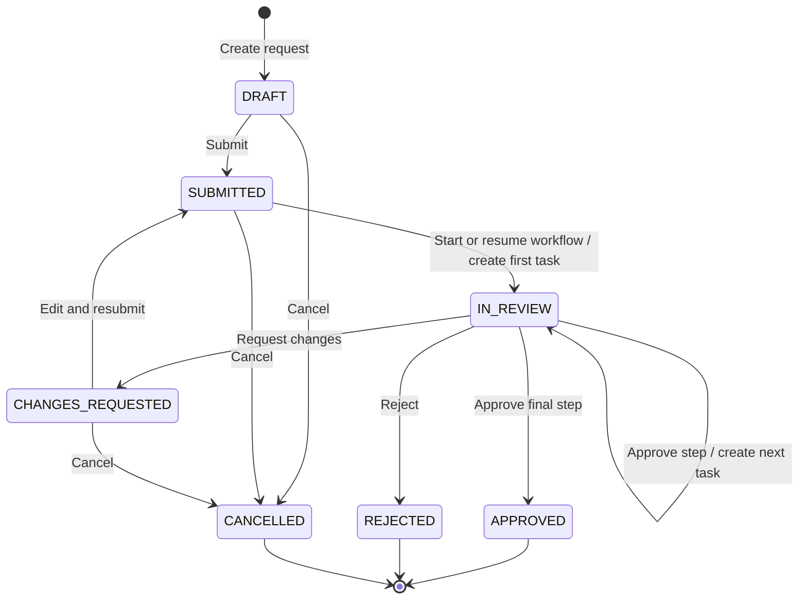
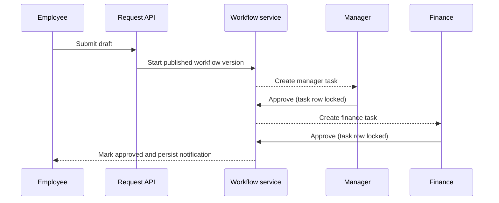

# Workflow state machine

Every transition is validated by backend domain logic inside a transaction. The frontend never determines whether a transition is valid.

## Decision sequence

## Concurrency behavior

Decision processing loads the approval task with a PostgreSQL pessimistic write lock. The first transaction changes it from `PENDING`; a competing transaction waits, then observes the terminal state and receives a conflict response. The request and workflow cannot diverge because task, decision, workflow, request, audit, and notification changes share the transaction.
